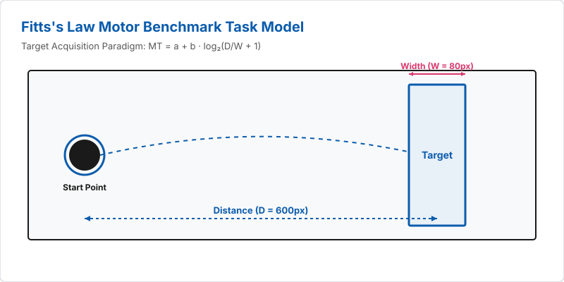

# HCI Landmark & Motor Performance Toolkit (`hci-landmark-analysis`)

A comprehensive, browser-native suite for evaluating human-computer interaction (HCI) metrics. This toolkit combines classical human-factors performance modeling (**Fitts's Law**) with real-time computer-vision landmark extraction using **Google MediaPipe**.

---

## 📸 System Diagrams & Modeling

| Fitts's Law Task Paradigm | MediaPipe Tracking Pipeline |
| :---: | :---: |
|  |  |


---

## 📖 Table of Contents

* [Module 1: Fitts's Law Motor Benchmark](https://www.google.com/search?q=%23-module-1-fittss-law-motor-benchmark-fittshtml)
* [Theoretical Background & Mathematical Model](https://www.google.com/search?q=%23-theoretical-background--mathematical-model)
* [Experimental Workflow](https://www.google.com/search?q=%23-experimental-workflow)
* [Regression Analysis & Interpretation](https://www.google.com/search?q=%23-regression-analysis--interpretation)


* [Module 2: MediaPipe Kinematic Estimator](https://www.google.com/search?q=%23-module-2-mediapipe-kinematic-estimator-mediapipe_3typeshtml)
* [Computer Vision Capabilities](https://www.google.com/search?q=%23-computer-vision-capabilities)
* [Kinematic Angle Vector Calculation](https://www.google.com/search?q=%23-kinematic-angle-vector-calculation)
* [Data Logging Schema (.CSV)](https://www.google.com/search?q=%23-data-logging-schema-csv-output)


* [Architecture & Tech Stack](https://www.google.com/search?q=%23-architecture--tech-stack)
* [Quickstart & Local Execution](https://www.google.com/search?q=%23-quickstart--local-execution)
* [Academic Attribution & License](https://www.google.com/search?q=%23-academic-attribution--license)

---

## 📌 Module 1: Fitts's Law Motor Benchmark (`fitts.html`)

### 🧠 Theoretical Background & Mathematical Model

Fitts's Law (Fitts, 1954; modified by MacKenzie, 1992) is a fundamental model of human psychomotor performance. It quantifies the trade-off between speed and accuracy when pointing to a target using an input device (e.g., mouse, trackpad, touchscreen, or finger gesture).

#### 1. Index of Difficulty ($ID$)

The Index of Difficulty measures the informational complexity of a movement task in **bits**. It depends logarithmically on the ratio between the movement distance ($D$) and the target width ($W$):

$$ID = \log_2\left(\frac{D}{W} + 1\right)$$

* **$D$ (Distance):** Distance from the center of the starting point to the center of the target (in pixels).
* **$W$ (Width):** Spatial tolerance or width of the target area (in pixels).

#### 2. Movement Time ($MT$)

Fitts's Law states that Movement Time ($MT$) is a linear function of $ID$:

$$MT = a + b \cdot ID$$

* **$a$ (Intercept / Reaction Base Time):** Represents the initial movement delay and device-start overhead in seconds.
* **$b$ (Slope / Speed Penalty):** Represents the rate of performance (seconds per bit of difficulty). A smaller value of $b$ indicates higher input device efficiency.

---

### 🕹️ Experimental Workflow

```
[Start Test] ──► [Click Start Point (Black Circle)] ──► [Rapid Movement] ──► [Click Target (Blue Rect)] ──► [Log MT]

```

1. **Parameter Configuration:**
* **Repetitions per condition:** Choose 3, 5, or 10 trials.
* **Input Device:** Specify Mouse, Trackpad, Touchscreen, or Other.


2. **Four Randomized Conditions:**
The experiment tests 4 distinct spatial configurations in randomized order to eliminate learning bias:

| Condition Name | Distance ($D$) | Width ($W$) | Index of Difficulty ($ID$) | Task Complexity |
| --- | --- | --- | --- | --- |
| **Near / Large** | 200 px | 80 px | $\log_2(200/80 + 1) \approx \mathbf{1.81\text{ bits}}$ | Low (Fastest) |
| **Near / Small** | 200 px | 20 px | $\log_2(200/20 + 1) \approx \mathbf{3.46\text{ bits}}$ | Moderate |
| **Far / Large** | 600 px | 80 px | $\log_2(600/80 + 1) \approx \mathbf{3.09\text{ bits}}$ | Moderate |
| **Far / Small** | 600 px | 20 px | $\log_2(600/20 + 1) \approx \mathbf{4.95\text{ bits}}$ | High (Slowest) |

---

### 📈 Regression Analysis & Interpretation

Upon trial completion, the application computes standard linear regression over the 4 condition averages to extract $a$ and $b$:

* **Mean Calculation:**

$$\bar{ID} = \frac{1}{N}\sum_{i=1}^{N} ID_i, \quad \bar{MT} = \frac{1}{N}\sum_{i=1}^{N} MT_i$$


* **Slope ($b$) and Intercept ($a$):**

$$b = \frac{\sum (ID_i - \bar{ID})(MT_i - \bar{MT})}{\sum (ID_i - \bar{ID})^2}$$


$$a = \bar{MT} - b \cdot \bar{ID}$$


The interactive HTML5 `<canvas>` renders the scatter plot of all conditions along with the fitted line $MT = a + b \cdot ID$.

---

## 📌 Module 2: MediaPipe Kinematic Estimator (`mediapipe_3types.html`)

### 🖐️ Computer Vision Capabilities

Powered by Google's `@mediapipe/tasks-vision` (v0.10.14) framework running natively in-browser via **WebGPU** (with automatic CPU fallback).

| Model Target | Landmark Count | Key Structural Trackers |
| --- | --- | --- |
| **Hand Landmarker** | **21 points** per hand | Wrist (0), Thumb Tip (4), Index Tip (8), Middle Tip (12), Ring Tip (16), Pinky Tip (20) |
| **Face Landmarker** | **478 points** | High-density facial mesh, eye contours, iris positions, lip contours |
| **Pose Landmarker** | **33 points** | Shoulders, Elbows, Wrists, Hips, Knees, Ankles, Feet |

---

### 📐 Kinematic Angle Vector Calculation

Real-time joint angles are derived using spatial 3D dot-product trigonometry. For example, the **Elbow Angle ($\theta$)** is calculated from Shoulder ($A$), Elbow ($B$), and Wrist ($C$):

#### Vector Definition:

$$\vec{u} = A - B = \begin{pmatrix} x_A - x_B \\ y_A - y_B \\ z_A - z_B \end{pmatrix}, \quad \vec{v} = C - B = \begin{pmatrix} x_C - x_B \\ y_C - y_B \\ z_C - z_B \end{pmatrix}$$

#### Dot Product and Norms:

$$\vec{u} \cdot \vec{v} = u_x v_x + u_y v_y + u_z v_z$$

$$\Vert{}\vec{u}\Vert{} = \sqrt{u_x^2 + u_y^2 + u_z^2}, \quad \Vert{}\vec{v}\Vert{} = \sqrt{v_x^2 + v_y^2 + v_z^2}$$

#### Angle Formula ($\theta$):

$$\theta = \arccos\left( \frac{\vec{u} \cdot \vec{v}}{\Vert{}\vec{u}\Vert{} \Vert{}\vec{v}\Vert{}} \right) \times \frac{180}{\pi}$$

* When the arm is fully extended, $\theta \to 180^\circ$.
* When the arm is bent at a right angle, $\theta \approx 90^\circ$.

---

### 📊 Data Logging Schema (.CSV Output)

Clicking **「記録を開始」** logs spatial coordinate vectors at camera frame rate. The exported `.csv` file adheres to the following specification:

```csv
t_ms,kind,index,landmark,x,y,z,wx,wy,wz,visibility

```

| Field | Type | Description |
| --- | --- | --- |
| `t_ms` | Float | Timestamp elapsed since recording start (milliseconds). |
| `kind` | String | Detection model domain: `hand`, `face`, or `pose`. |
| `index` | Integer | Index of detected entity (e.g., Hand 0 vs. Hand 1). |
| `landmark` | Integer | Landmark identification ID (0–20 for hand, 0–32 for pose, 0–477 for face). |
| `x` | Float | Normalized horizontal position ($[0.0, 1.0]$, relative to frame width). |
| `y` | Float | Normalized vertical position ($[0.0, 1.0]$, relative to frame height). |
| `z` | Float | Estimated landmark depth relative to camera frame origin. |
| `wx` | Float | World metric coordinate X (meters, centered at midpoint of hips). |
| `wy` | Float | World metric coordinate Y (meters, centered at midpoint of hips). |
| `wz` | Float | World metric coordinate Z (meters, centered at midpoint of hips). |
| `visibility` | Float | Landmark presence confidence probability score ($[0.0, 1.0]$). |

---

## 🛠️ Architecture & Tech Stack

* **Frontend:** Modular JavaScript (ES6+ Native Imports), HTML5 `<canvas>` rendering engine, CSS Flexbox/Grid layout.
* **ML Vision Backend:** Google `@mediapipe/tasks-vision` CDN distribution.
* **Privacy Model:** **Zero network transmission.** Video frames are processed entirely within browser client memory.

---

## 🚀 Quickstart & Local Execution

### Prerequisites

* Google Chrome or Microsoft Edge (latest version recommended).
* WebCamera (for MediaPipe landmark tracking).

### Local Setup

1. Clone the repository:
```bash
git clone https://github.com/sach7742/hci-landmark-analysis.git
cd hci-landmark-analysis

```


2. Start a local HTTP server (required to fulfill `getUserMedia` security requirements):
```bash
python3 -m http.server 8000

```


3. Open `http://localhost:8000` in your web browser.

---

## 📜 Academic Attribution & License

Developed as part of the **Interface Technology & Systems Experiments** coursework. ML models and pipeline architectures are derived from Google MediaPipe Research.